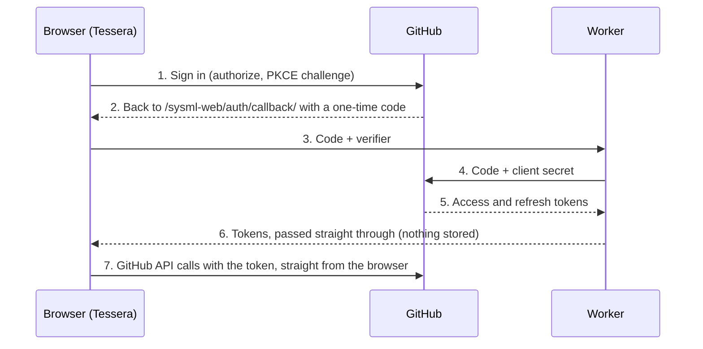

# Setting up "Sign in with GitHub"

You register two things once, a Cloudflare worker and a GitHub App, then put
their IDs into the worker and into the site's build variables. After that,
anyone can tap **Sign in with GitHub** wherever Tessera asks to connect
GitHub, instead of creating an access token.

Until this is set up the site works as before: people connect with a
fine-grained personal access token. That stays available afterwards too, as
"Use an access token instead".

Nothing about your users is stored on your side. The worker swaps a one-time
sign-in code for a token (adding the app's client secret, which the browser
must never hold) and hands the answer straight back to the browser. It does
the same to refresh a token. Everything else goes from the browser straight
to the GitHub API.

| Where                | What you create                                 | Public values (safe in the site build) | Secrets (worker only) |
| -------------------- | ----------------------------------------------- | -------------------------------------- | --------------------- |
| Cloudflare           | Worker `sysml-web-sync` (dashboard or Wrangler) | Worker URL                             | —                     |
| GitHub               | GitHub App                                      | Client ID, app slug                    | Client secret         |
| GitHub repo settings | Actions variables for the Pages build           | All of the public values above         | —                     |



The callback URL is
`https://jackhale98.github.io/sysml-web/auth/callback/` (with the trailing
slash). If the site moves, update it in the GitHub App and the origin in the
worker's `ALLOWED_ORIGINS`.

## Step 1 — Deploy the Cloudflare worker

The worker is the only server piece. It runs on Cloudflare's free plan
(100,000 requests a day; each person signs in once and refreshes about every
8 hours while they use the app) and takes about five minutes. Do this first:
the other steps need its URL.

### Option A — From the Cloudflare dashboard (recommended)

Cloudflare builds the worker straight from the `worker` folder of this
repository and redeploys it whenever that folder changes on `main`.

1. Create a free account at [dash.cloudflare.com](https://dash.cloudflare.com/sign-up)
   and sign in.
2. Open **Workers & Pages** (under **Compute** in the sidebar) and select
   **Create application**.
3. Choose **Import a repository** (the GitHub option). If asked, connect your
   GitHub account and allow Cloudflare access to `jackhale98/sysml-web` (you
   can limit it to just this repository).
4. Select the `sysml-web` repository and fill in the project settings:

   | Field                 | Value                                                           |
   | --------------------- | --------------------------------------------------------------- |
   | Project name          | `sysml-web-sync` (must match `name` in `worker/wrangler.jsonc`) |
   | Production branch     | `main`                                                          |
   | Build command         | Leave empty                                                     |
   | Deploy command        | `npx wrangler@4 deploy`                                         |
   | Root directory / Path | `worker` (under **Advanced settings** if it's collapsed)        |
   | Build variables       | None                                                            |

5. Select **Save and Deploy** (or **Create and deploy**). The first build takes
   a minute or two; you can watch its log on the worker's **Deployments** tab.
6. When it finishes, the worker's page shows its URL, for example
   `https://sysml-web-sync.<your-subdomain>.workers.dev`. Keep it for Step 3.
7. Only rebuild when the worker changes: open the worker → **Settings** →
   **Build** → **Build watch paths**, and set **Include paths** to `worker/*`.
   Otherwise every push to `main` redeploys the worker. That's harmless, just
   unnecessary.

**Allowed origins live in the repository, not the dashboard.**
`ALLOWED_ORIGINS` is set in `worker/wrangler.jsonc`, and every build applies the
file's value, so a variable edited in the dashboard would be overwritten on the
next deploy. It lists `https://jackhale98.github.io` (an origin, no path) and
`http://localhost:5173` and `http://localhost:4173` for local development
(`npm run dev` and `npm run preview`). To change it, edit the file on GitHub
(open it, select the pencil icon, commit to `main`) and Cloudflare redeploys by
itself.

### Option B — With Wrangler from a terminal

In a local clone of `sysml-web`, deploy from the `worker` folder:

```sh
cd worker
npx wrangler login
npx wrangler deploy
```

Wrangler prints the worker's URL. Check `ALLOWED_ORIGINS` in
`worker/wrangler.jsonc` as described above, and deploy again if you changed it.

If you'd rather deploy from GitHub Actions, add a `CLOUDFLARE_API_TOKEN`
repository secret (Cloudflare token template "Edit Cloudflare Workers") and run
the **Deploy worker** workflow in the Actions tab. Use only one of Option A or
the Actions workflow, so two deploy paths don't race each other.

### Check it

Open the worker's URL in a browser tab. You should see "Origin not allowed":
the worker answers only the site, which is what you want.

## Step 2 — Register the GitHub App

Use a GitHub App rather than an OAuth App: people choose exactly which
repositories it may use, and its sign-in tokens expire after 8 hours and
refresh automatically (for about 6 months, after which people sign in again).

1. Go to [GitHub → Settings → Developer settings → GitHub Apps → New GitHub App](https://github.com/settings/apps/new).
   (To own it as an organisation, use the organisation's **Settings →
   Developer settings → GitHub Apps** instead.)
2. Fill in the form:

   | Field                                                  | Value                                                   |
   | ------------------------------------------------------ | ------------------------------------------------------- |
   | GitHub App name                                        | `Tessera` (must be unique on GitHub; any name works)  |
   | Homepage URL                                           | `https://jackhale98.github.io/sysml-web/`               |
   | Callback URL                                           | `https://jackhale98.github.io/sysml-web/auth/callback/` |
   | Expire user authorization tokens                       | Checked                                                 |
   | Request user authorization (OAuth) during installation | Checked                                                 |
   | Enable Device Flow                                     | Unchecked                                               |
   | Webhook → Active                                       | Unchecked (the app needs no events)                     |
   | Repository permissions → Contents                      | Read and write                                          |
   | Repository permissions → Pull requests                 | Read and write (for "Propose changes")                  |
   | Repository permissions → Metadata                      | Read-only (GitHub sets this automatically)              |
   | All other permissions                                  | No access                                               |
   | Where can this GitHub App be installed?                | Any account (so others can use your site)               |

3. Click **Create GitHub App**.
4. On the app's page, note the **Client ID** (starts with `Iv`).
5. Click **Generate a new client secret** and copy it now; GitHub shows it only once.
6. Note the app's **slug**: the last part of its public URL,
   `https://github.com/apps/<slug>`. The site uses it for "Choose repositories
   on GitHub".

You don't need a private key: the app never acts on its own, only on behalf of
the signed-in person.

The first time someone signs in, GitHub asks them to approve Tessera. If the
app isn't on any of their repositories yet, the app shows **Choose
repositories on GitHub**, which installs it on the repositories they pick and
brings them straight back. They can add or remove repositories later the same
way, or under GitHub → Settings → Applications.

## Step 3 — Wire it up

The secrets go into the worker; the public IDs go into the site's build.

**Worker secrets.**

_In the dashboard:_ open **Workers & Pages** → `sysml-web-sync` → **Settings**
→ **Variables and Secrets** → **Add**. For each row below, choose type
**Secret**, enter the name and paste the value, then select **Deploy**.
Secrets added this way stay in place across later builds (the worker is
deployed with `keep_vars`).

| Name                   | Value                    |
| ---------------------- | ------------------------ |
| `GITHUB_CLIENT_ID`     | GitHub App client ID     |
| `GITHUB_CLIENT_SECRET` | GitHub App client secret |

Don't use **Build** → **Variables and secrets** for these: those are visible
only while the worker is being built, not when it runs.

_With Wrangler:_ from the `worker` folder, run each command and paste the
value when asked:

```sh
npx wrangler secret put GITHUB_CLIENT_ID
npx wrangler secret put GITHUB_CLIENT_SECRET
```

Either way, secrets take effect right away; no rebuild is needed.

**Site build variables.** In `jackhale98/sysml-web` on GitHub, open
**Settings → Secrets and variables → Actions → Variables** and add:

| Variable                  | Value                                                                       |
| ------------------------- | --------------------------------------------------------------------------- |
| `PUBLIC_GITHUB_CLIENT_ID` | GitHub App client ID                                                        |
| `PUBLIC_GITHUB_APP_SLUG`  | GitHub App slug                                                             |
| `PUBLIC_SYNC_WORKER`      | The worker URL from Step 1, e.g. `https://sysml-web-sync.<you>.workers.dev` |

Use **Variables**, not Secrets: these values end up in the published
JavaScript anyway, and the Pages build (`.github/workflows/deploy.yml`) reads
them as variables. The button appears only when both the client ID and the
worker URL are set.

**Redeploy.** Open **Actions → Deploy to GitHub Pages → Run workflow** on
`main`. (Any later push to `main` also picks them up.)

## Step 4 — Check it

Open https://jackhale98.github.io/sysml-web/projects and select **Connect
GitHub…**. You should see **Sign in with GitHub**, with "Use an access token
instead" below it.

- [ ] Sign in with GitHub, approve, and you come back to the same dialog,
      signed in
- [ ] If the list is empty, **Choose repositories on GitHub**, pick one with
      SysML files, and you come back to the list with it
- [ ] Open it, change a file, **Save to GitHub**; the commit appears on GitHub
      under your name
- [ ] Start a branch and **Propose changes**; the pull request appears
- [ ] On a phone (and in the installed app), sign in from a project's GitHub
      sheet; you come back to the sheet, signed in

**Troubleshooting**

| Symptom                                               | Likely cause                                                 | Fix                                                                                                                 |
| ----------------------------------------------------- | ------------------------------------------------------------ | ------------------------------------------------------------------------------------------------------------------- |
| No "Sign in with GitHub" button                       | Build variables missing, or the site wasn't redeployed       | Check the variable names in Step 3 and re-run the Pages deploy                                                      |
| GitHub says the redirect URI is invalid               | Callback URL differs by a character (trailing slash, `http`) | Use exactly `https://jackhale98.github.io/sysml-web/auth/callback/`                                                 |
| "GitHub sign-in isn't available at this address"      | `ALLOWED_ORIGINS` doesn't list the site's origin             | Add it in `worker/wrangler.jsonc` on `main` (Option A rebuilds by itself; with Option B run `npx wrangler deploy`)  |
| "GitHub sign-in isn't set up on this site yet"        | A worker secret is missing (the worker answers 501)          | Add it under the worker's **Settings → Variables and Secrets**, or `npx wrangler secret put …`                      |
| "isn't set up correctly for this site yet"            | Wrong client secret, or the callback URL doesn't match       | Generate a new client secret and set it again; check the callback URL                                               |
| Dashboard build fails: name mismatch                  | Project name isn't `sysml-web-sync`                          | Rename the worker to match `name` in `worker/wrangler.jsonc`, or change the file                                    |
| Dashboard build fails: no Wrangler config             | Root directory isn't `worker`                                | Worker → **Settings → Build** → set the root directory to `worker` and retry                                        |
| The repository list is empty, or a repository missing | The app isn't installed on it                                | **Choose repositories on GitHub** in the dialog (or Settings → Accounts)                                            |
| "Propose changes" is refused                          | The app lacks the Pull requests permission                   | Set **Pull requests: Read and write** in the app's settings; installations must accept the new permission on GitHub |
| "Your GitHub sign-in has expired"                     | The refresh token expired (after ~6 months) or was revoked   | Sign in again                                                                                                       |

To see the worker's own answer, open the browser's developer tools on the
callback page: a failed request to the worker shows its status and message.

**Security notes**

- Tokens are kept only in the visitor's browser. The worker sees the one-time
  code and the refresh token only while it forwards them to GitHub; it stores
  nothing and has logging off.
- The app can reach only the repositories each person chose for it, with
  Contents and Pull requests read and write.
- To cut off everything at once, generate a new client secret (and delete the
  old one) in the GitHub App: existing sign-ins then can't refresh.
- If the worker is on a domain of your own, add a Cloudflare rate-limiting
  rule for it (for example 60 requests a minute per IP).

**Fallback: access tokens.** Sign-in is optional. People can always choose
"Use an access token instead" and paste a fine-grained personal access token
with "Contents: Read and write" (and "Pull requests: Read and write" to
propose changes) on the repositories they want.

**GitHub Enterprise Server.** The worker and "Sign in with GitHub" talk to
github.com only (the worker posts to `https://github.com/login/oauth/…`).
People on a GitHub Enterprise Server use access tokens instead: in
**Settings → Accounts → GitHub Enterprise Server** they enter the server's
address (`https://github.example.com`; the app uses its API at
`/api/v3`), then connect with a token made on that server. The account
remembers its server and the token is sent only to it; while a server is
set, the connect form offers the token only. The server must allow this
site's origin for cross-origin requests to its API (GitHub Enterprise
Server does for `/api/v3` by default). No worker is needed for that route.

